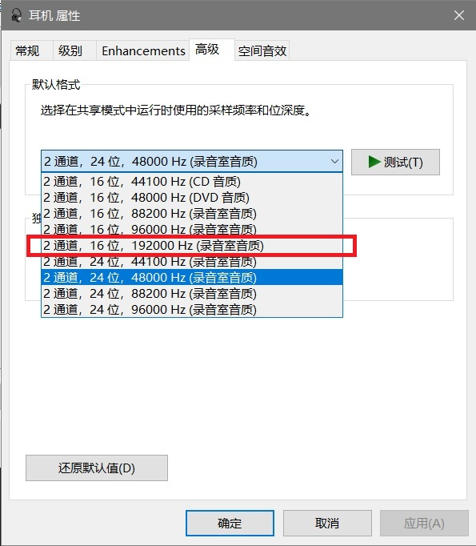

# ASUS-MU3C-AD-M2--FW-Updater  
A patched ASUS MU3C AD (M2) firmware based on v3.6.14.  
## How to use?  
Download [ASUS-MU3C-AD(M2)-FW-Updater.zip](https://github.com/riuzenn/ASUS-MU3C-AD-M2--FW-Updater/blob/main/ASUS-MU3C-AD(M2)-FW-Updater.zip), unzip it, and run ESS_SuiteFW.exe.  
or Download [ES9260_3.6.15_EXT.rom](https://github.com/riuzenn/ASUS-MU3C-AD-M2--FW-Updater/blob/main/ES9260_3.6.15_EXT.rom)，then move it to the AppData folder.  
## See [华硕小尾巴MU3C-AD(M2)玩机总结](https://www.bilibili.com/opus/1269802210612477976) for documentation of the patching and flashing process.  
## This patch mainly provides three improvements, at the cost of 16-bit recording at 24 kHz and 48 kHz while retaining 24-bit recording support:  
◉Enables volume control when the ASUS dongle is connected to Apple devices or when Exclusive Mode is enabled.  
◉ Set `bMaxPower` to 0x32 (50 × 2 mA = 100 mA; previously 0) to avoid potential compatibility issues on systems with strict power management.  
◉Adds the following playback formats to 4-pole 3.5 mm plug mode:  
- 44.1 kHz and 88.2 kHz stereo for 16-bit playback  
- 44.1 kHz and 88.2 kHz stereo for 24-bit playback

  

## The 24-bit/96 kHz ceiling of the ASUS MU3C AD (M2) is primarily a limitation of the integrated USB 1.1 bridge—not a lack of DAC capability and not a deliberate firmware limitation.  
### 1. Capability mismatch: strong DAC, weak USB bridge  
- The ES9260Q’s DAC module supports 32-bit/384 kHz PCM and DSD256.
- Its USB module, however, uses a USB 1.1 PHY, so data fed from the host over USB is limited by the USB bridge’s bandwidth
### 2. Bandwidth budget makes 24/96 a reasonable ceiling for the internal USB path  
- USB 1.1 has a theoretical line bandwidth of 12 Mbps, with a theoretical payload bandwidth of about  
1023 × 8 × 1000 ÷ 1,000,000 = 8.184 Mbps.  
- 24-bit/96 kHz stereo:  
24 × 96,000 × 2 ÷ 1,000,000 = 4.608 Mbps, within the payload budget.  
- 24-bit/176.4 kHz stereo:  
24 × 176,400 × 2 ÷ 1,000,000 = 8.4672 Mbps, already exceeding the theoretical payload bandwidth; 192 kHz is even less feasible.
### 3. Descriptor changes can attempt to add formats  
In principle, one could try adding the following formats to the descriptors:  
- 16-bit/192 kHz stereo  
- 32-bit/96 kHz stereo
The endpoint maximum packet size must also be updated accordingly. The calculation is:  
channels × bit depth × sample rate ÷ 1000 ÷ 8 + channels × bit depth ÷ 8, taking the packet size required by the highest format.  
In practice: I tried to add 16/192, but it didn't work in Exclusive Mode: the music player reported that playback failed because the device could not be opened. The latter (32/96) was not tested.  

  

